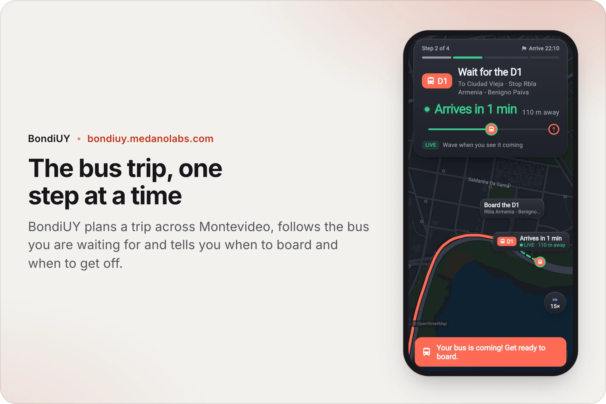
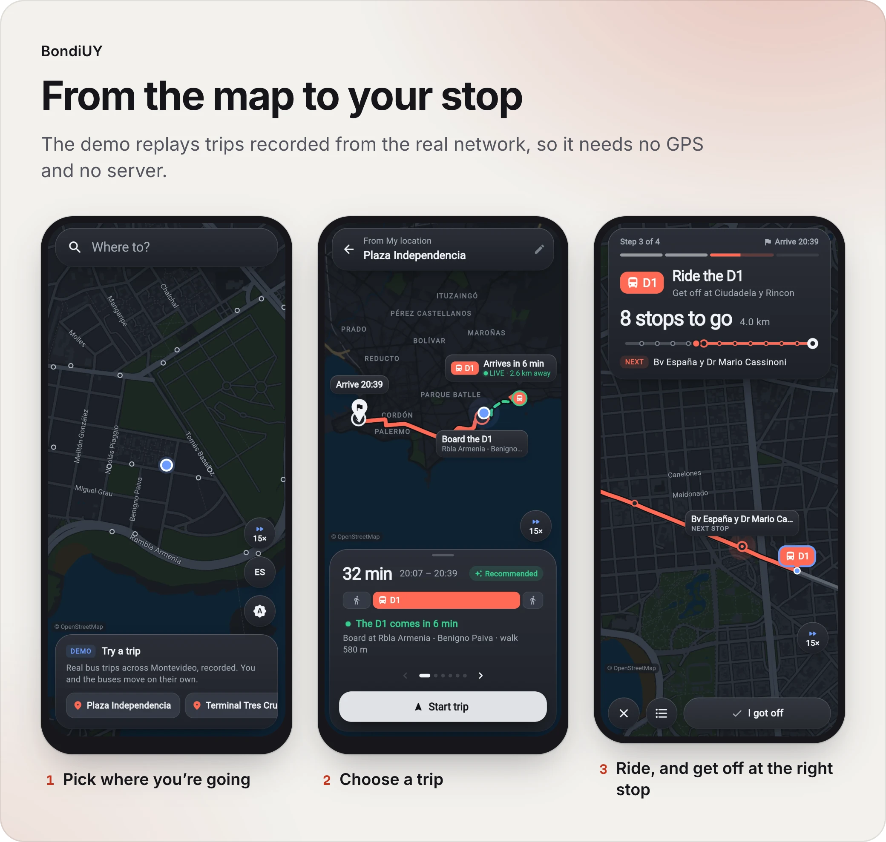

# BondiUY

A Flutter app (Android and web) for bus trips across Montevideo, designed "grandma first": it recommends one option,
shows the trip on a map (light or dark), and advances through the steps on its own using the GPS: walk, wait for the
live bus, ride, walk, arrive.

**[Try the demo](https://bondiuy.medanolabs.com)** · **[Download for Android](https://github.com/Felichz/bondi-uy/releases/latest)** · **[Case study](https://felix.medanolabs.com/work/bondiuy/)** · **Author: [Felix Andersson](https://felix.medanolabs.com)**

Product and vision: [PRODUCT.md](PRODUCT.md) · Visual language: [DESIGN.md](DESIGN.md) ·
Flows: [docs/flujos/flujo-principal](docs/flujos/flujo-principal/1-flujo-de-user.txt)

<picture>
  <source media="(prefers-color-scheme: dark)" srcset="docs/readme/01-wait-dark.webp">
  
</picture>

<picture>
  <source media="(prefers-color-scheme: dark)" srcset="docs/readme/02-trip-dark.webp">
  
</picture>

## Architecture

```
lib/
  contract/   the ONLY point of contact between the UI and the logic
    app_state.dart      state (explore / options / trip phases), raw data
    app_actions.dart    the user's intents
    providers.dart      appStateProvider + appActionsProvider (the root wires them)
  logic/      data and rules: knows no widgets, maps, colors or copy
    app_controller.dart      implements AppActions
    trip/trip_navigator.dart  finds the current step from the GPS (pure, deterministic)
    trip/bus_tracker.dart     live bus, and its approach along the GTFS shape
    trip/recommender.dart     deduplicates the options and picks the recommended one
    services/    OTP, Montevideo's bus API, geocoding (Photon/Mapbox), GPS, GTFS
    simulation/  a simulated world (synthetic GPS and buses) and recorded sources
  ui/         presentation: formats, animates, draws the map, decides the camera
    map/        the app's own map renderer (OSM vector tiles, light and dark)
    theme/       colors, material (sheets), badges, theme preference
    explore/ search/ options/ trip/   panels per phase
  main.dart   composition root
```

Rules:

- The UI only reads `AppState` and calls `AppActions`; it never imports `lib/logic`.
- The logic sends numbers, enums and proper names, never presentation text.
- Mapbox, the map and the camera belong to the UI.

## Run the app

Requirements: Flutter 3.29, the Android SDK and JDK 21.

```bash
flutter run -d emulator-5554 --dart-define=BONDI_MODO=simulado
```

| `BONDI_MODO` | Planning | GPS and buses | Network |
|---|---|---|---|
| `real` (default on a phone) | OTP | the phone + Montevideo's bus API | yes |
| `demo` (default on the web) | 5 real trips recorded from Malvín (`assets/demo/`) | simulated, 1× to 30× | map tiles only |
| `simulado` | real OTP | move on their own (6×) along real streets and shapes | yes |
| `grabado` | a recorded OTP plan (Saldanha da Gama → Plaza Independencia) | simulated | map tiles only |

Credentials stay out of git: copy `config/dev.example.json` to `config/dev.json`, fill it in and run with
`--dart-define-from-file=config/dev.json`. Without the city's credentials the app works, but with no live buses.
Geocoding uses Photon (OSM, no key) unless `MAPBOX_TOKEN` is set.

### The public demo (web and APK)

The demo needs no server of its own: the trips were planned with a local OTP and recorded
(`tool/capture_trip.dart`), and the user and the buses are simulated. English and Spanish (from the device,
`?lang=en|es` on the web, or the ES/EN button).

```bash
scripts/bondi.ps1 web                       # build/web, the public demo at bondiuy.medanolabs.com
npm run deploy                              # builds build/web and publishes it (Cloudflare Worker, wrangler.jsonc)
scripts/bondi.ps1 web -Base /apps/bondiuy/  # to embed it in the portfolio
scripts/bondi.ps1 apk                       # dist/BondiUY-demo.apk, attached to each GitHub release
```

On a wide screen the web shows the app inside a phone, with a presentation beside it; `?marco=0` shows it full
screen (for iframes).

### Local OTP server

OTP 2.7 with Montevideo's GTFS and the OSM extract of Uruguay, in a folder of its own:

```bash
java -Xmx6G -jar otp-shaded-2.7.0.jar --build --save .
```

```bash
java -Xmx3G -jar otp-shaded-2.7.0.jar --load --serve .
```

The emulator reaches it at `http://10.0.2.2:8080` (the default). On a physical phone, use
`--dart-define=OTP_URL=http://<your-pc-ip>:8080/otp/routers/default/index/graphql`.

## Tests

```bash
flutter test
```

See [docs/testing/README.md](docs/testing/README.md): the logic against real recorded data, and the
whole app headless (map included, light and dark) with screenshots in `build/capturas/`.

## Tools

- `tool/capture_trip.dart`: records an OTP trip and real bus polls from the city as a fixture.
- `tool/generate_shapes_geojson.dart`: GTFS shapes → `assets/data/shapes.geojson`.
- `tool/generar_paradas_geojson.py`: GTFS stops and lines → `assets/data/stops.geojson`.
- `tool/generar_iconos.py`: Android and web icons.

## License

[MIT](LICENSE). Map data © OpenStreetMap contributors (via OpenFreeMap); bus data from the Intendencia de Montevideo.
